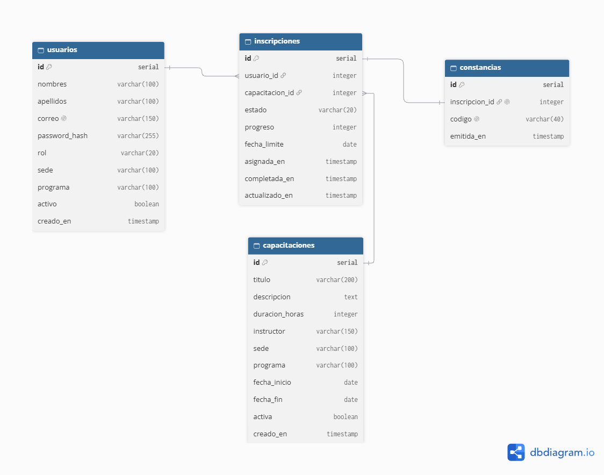
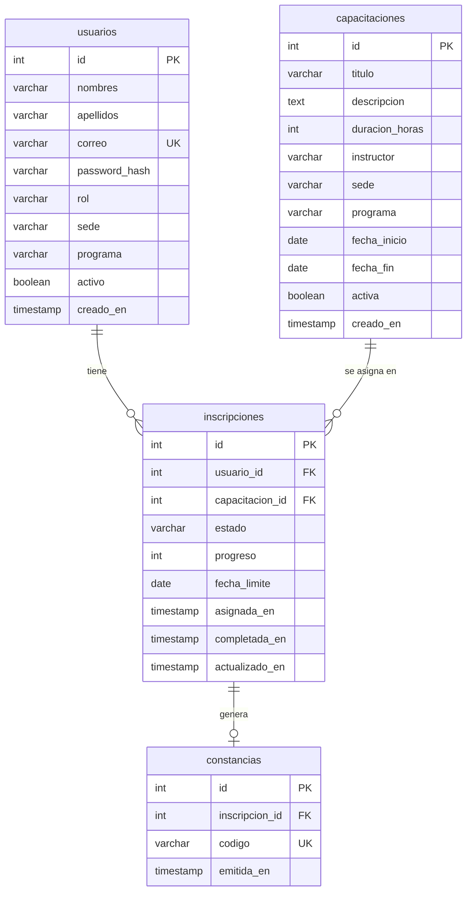

# Modelo de datos

Base de datos PostgreSQL del sistema de Capacitación Docente (CERTUS). El esquema completo está en `database/schema.sql` y los datos de ejemplo en `database/seed.sql`.

## Diagrama entidad-relación





## Tablas

| Tabla            | Para qué sirve                                                                                                               |
| ---------------- | ---------------------------------------------------------------------------------------------------------------------------- |
| `usuarios`       | Docentes y administradores (gestores), diferenciados por la columna `rol`.                                                   |
| `capacitaciones` | Catálogo de capacitaciones con duración, instructor, sede, programa y fechas.                                                |
| `inscripciones`  | Qué docente tiene asignada qué capacitación, con su estado (`pendiente`, `en_curso`, `completada`) y su progreso de 0 a 100. |
| `constancias`    | Una constancia por inscripción completada, con un código único para verificarla.                                             |

## Reglas que protege la base de datos

| Restricción                            | Regla de negocio                                               |
| -------------------------------------- | -------------------------------------------------------------- |
| `usuarios.correo UNIQUE`               | No hay dos cuentas con el mismo correo.                        |
| `CHECK (rol IN ...)`                   | Solo existen los roles docente y administrador.                |
| `CHECK (estado IN ...)`                | Solo hay tres estados: pendiente, en curso y completada.       |
| `UNIQUE (usuario_id, capacitacion_id)` | No se asigna dos veces la misma capacitación al mismo docente. |
| `constancias.inscripcion_id UNIQUE`    | La constancia se genera una sola vez por inscripción.          |
| `usuarios.activo`                      | Los usuarios se desactivan, no se eliminan.                    |

## Recrear la base en 2 comandos

Con Docker encendido (`docker compose up -d`), desde la raíz del proyecto.

Git Bash:

```bash
docker compose exec -T db psql -U capacitaciones -d capacitaciones_db < database/schema.sql
docker compose exec -T db psql -U capacitaciones -d capacitaciones_db < database/seed.sql
```

PowerShell:

```powershell
Get-Content database\schema.sql -Raw | docker compose exec -T db psql -U capacitaciones -d capacitaciones_db
Get-Content database\seed.sql -Raw | docker compose exec -T db psql -U capacitaciones -d capacitaciones_db
```

Si cambiaste el usuario o la base en tu `.env`, usa esos nombres.

> Los `DROP` del esquema borran los datos existentes. Úsalo solo en desarrollo.
